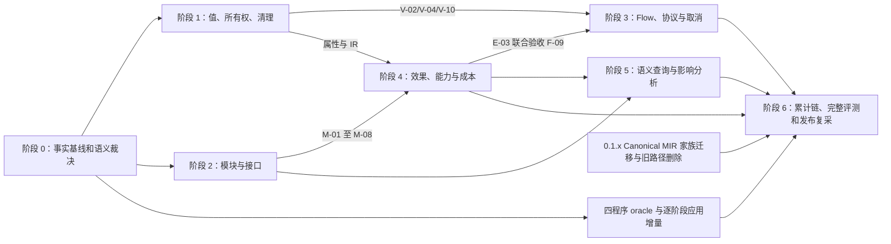

# Mimi 0.2 规划总览

> 状态：**提案 / 执行规划，尚非已生效的语言规范**。建立于 2026-09-24。
> 范围：外部版本 **0.2.0** 的产品目标、语义裁决、工程任务和发布验收；内部 `0.42` 等 sprint 编号不是 `0.2`。
> 输入：用户提供的《普通代码容易写对，资源协议能够静态检查，修改影响和性能代价能够被解释》判断，以及本仓库现行内核、规范和 MIR 路线。2026-09-24 收尾裁决：**范围大不是降目标的理由；范围缩到达不到目标才是失败**。

## 一句话目标

把 Mimi 做成一门可写真实原生应用的通用语言：普通数据按值理解，资源的清理由所有权负责，必须完成的协议由静态检查负责；模块接口能限制修改影响，效果和成本边界能解释一次调用的代价，Flow 约束真正依赖阶段的操作。

0.2 的完成含义是**四类真实程序及跨程序组合测试自然使用了完整的核心规则**，并且这些能力在检查器、Canonical MIR、VM、native、验证器与工具中有同一含义。它不是 1.0 稳定性承诺，也不是“所有现存 Mimi 程序自动迁移完毕”。

## 0.2 不可缩减的交付合同

G1～G7 是同一次 `0.2.0` 发布的**并列必需目标**，不是供挑选的能力菜单。实现困难时增加阶段、人员、工具、基建或继续保持开发版本；不得为了按期发布而删除必需任务、降低验收分母、把自然写法改成特例、把必需能力标成实验，或仅在选定样例中接通完整语义。裁决可以改变实现和语法，但必须用等价或更强的证据满足原目标；目标本身只有经明确的新产品决策才能变更，本目录不能自行暗改。

0.2 的**完整目标面**至少包括：普通值的可观察隔离与独占热点写法；自动清理和严格协议义务在复合类型、泛型、闭包、控制流与任务边界递归组合；Flow 对阶段的约束及多个独立 Flow 的真实协作；限定模块身份、公开接口和完整公共标准库迁移；可强制传播的有限效果、文件与网络范围能力；全路径 `no_alloc` 与分层成本说明；语义查询、诊断、修改影响分析；四类应用、真实持续修改和独立验证。实现报告必须逐项给出正例、负例和端到端证据。

下文的非目标仅指 GPU 自动调度、任意 Zig 验证等**另一个产品命题**。不要求证明整门语言可被 SMT 完全验证，也不允许把已声明的合同悄悄当作无需验证；不要求任意平台，却要求每个**宣称支持的目标平台**满足完整合同。实验 profile 可以先行开发，不能替代正式发布结果。

## 阅读顺序

| 文档 | 用途 |
|---|---|
| [01-语义核心.md](01-语义核心.md) | 候选语义：值、所有权、协议、Flow、模块、效果、能力、成本；列出需要改判的旧规则 |
| [02-阶段与任务.md](02-阶段与任务.md) | 依赖、阶段、任务 ID、可交付物和逐项验收 |
| [03-验收程序与评测.md](03-验收程序与评测.md) | 四类真实程序、持续修改任务、双后端与 AI 实验的固定口径 |
| [04-迁移与发布.md](04-迁移与发布.md) | breaking 变更、迁移顺序、风险、发布门禁和证据包 |
| [05-待裁决问题.md](05-待裁决问题.md) | 与现行裁决冲突的选项、推荐方案、实验与决定记录模板 |
| [06-深度审计记录.md](06-深度审计记录.md) | 本轮查缺补漏发现的问题、修订位置与仍待实施验证的边界 |
| [07-2026-09-29现状与补强.md](07-2026-09-29现状与补强.md) | 当前源码与证据快照、0.2 对应差距、近期施工顺序和不得误算的覆盖率 |
| [08-执行与证据合同.md](08-执行与证据合同.md) | 开工/验收状态、P0 实物交付、跨阶段应用增量、连续链、证据与容量管理 |
| [plan.toml](plan.toml) / [结构检查器](tools/check_plan.py) | 71 项任务、14 项决策的状态与依赖；检查结构一致性，不冒充功能或发布验收 |

## 当前基线与权威边界

- **最新排期裁决（2026-09-29）**：从干净的 `4fbf6e40` / `0.1.11-dev` 开始，先完整收口普通 Map/Any 所有权、两个 Actor fallback 和四类可达 legacy owner，再切 `0.2.0-dev`；见 [交接门禁](09-0.1.11交接门禁.md)。以下旧快照保留为历史事实，不覆盖此项要求。
- 2026-09-29 的上一份复核快照对应 `51c9b101`，完整路由采样来自更早的 `d0d8e7f4`：222 输入，26 Canonical / 191 legacy / 5 拒绝，四个旧 owner 仍可达。这些是有提交边界的历史证据。此次计划深化开始读取时 HEAD 已为 `b1e81324`（native Any 解包拒绝修复），工作树还有四个 codegen 文件未提交，包版本仍为 `0.1.10-dev`；本次未重采全量测试、路由和内存结果。B-01 必须重新绑定源码/差异、工具链和产物，不能继承历史绿灯。普通 Map/Any、Actor/Flow native、C export 等完整合同尚未闭合，发布仍无新增通过依据。[快照及后续变化](07-2026-09-29现状与补强.md)
- 现行语言规则以 [内核卡](../kernel-card.md)、[语言规范](../../docs/language-spec.md)、源码及其测试为准。0.2 本目录中的新行为均标为**候选**，在单独裁决、更新规范与内核卡、实现并重新挣绿之前，不能用于声称当前 Mimi 已支持。
- [0.1.10 以后工程路线](../kernel-roadmap-0.1.10-plus.md)负责 0.1.x 的 MIR 迁移、旧路径删除与发布门禁。0.2 的语义实验可以提前做，但**0.2 已发布 profile**不得依赖隐藏 compatibility 回退。
- [Grouped Flow 与 zigmi 愿景](../vision-grouped-flow-and-zigmi.md)提出跨代方向。其中独立 Flow 的可用组合是 0.2 必需能力，直接嵌套的语法与隐式组合协议仍须 D-04 裁决；任意 Zig 状态机提升、DAG 级联证明及合规报告属于另一个产品命题，正式边界见 [D-09](05-待裁决问题.md#d-09-旧-02-愿景的范围)。在裁决前，旧愿景和本计划均不能冒充已通过的发布合同。

## 目标、边界与衡量

| ID | 0.2 目标 | 可观察验收 |
|---|---|---|
| G1 | 普通代码容易写对 | 文件/JSON 工具、文档/图像核心、数组/音频内核与网络服务完成固定需求及后续修改；普通字段更新、集合使用不要求 Flow 仪式 |
| G2 | 值、独占资源、协议义务组合一致 | `Option`、`Result`、记录、列表、闭包、泛型中的 move/借用/清理/必须结算按同一递归规则处理；正例通过、遗漏/二次消费在执行前拒绝 |
| G3 | Flow 精确用于阶段约束 | 文档关闭、导出完成/失败/取消等阶段被静态约束；普通缓存/坐标更新仅需封装和独占修改；Actor/长期普通状态的旧裁决须先修订；组合不产生隐式乘积状态或事务承诺 |
| G4 | 模块和效果限制修改传播 | 两个同名导出库可共存；公开接口记录类型、权限、效果与关键约束；私有体修改的 API、重编及可能的行为/测试影响分别可查询，新增效果越过接口时编译失败 |
| G5 | 成本可解释且关键约束可检查 | 报告明确区分“必然”“可能”“本次实测”；被声明为无分配的热点在所有可达路径上静态成立，否则拒绝并指出调用链 |
| G6 | 人和 AI 能可靠持续修改 | 语义查询与诊断原因链可用；真实模型实验与独立人类维护者交接按冻结任务、预算、参考验收与消融条件达到预注册目标，不用手写失败样例代替模型输出 |
| G7 | 原生产品质量 | 覆盖完整 G1～G6、W1～W4 和公开 stdlib 的 Mimi 调用图默认路由同一 Canonical MIR；外部 FFI 通过显式受信摘要/ABI 边界；L1/L2/L3、证明结论、sanitizer、取消与可复现安装证据齐全 |

衡量分母和阈值见 [验收文档](03-验收程序与评测.md)。某个目标的测试只证明登记的支持范围，不能扩大解释为任意容器、任意任务或任意 SMT 证明。

| 目标 | 主要任务 | 主要验收程序 |
|---|---|---|
| G1 | V-01～V-08、V-11～V-12、M-06、A-01～A-03、A-09～A-10 | W1～W4、嵌套/索引修改、普通 Map/Any 与累计演进 |
| G2 | V-02～V-12、F-04～F-10 | W2 结算、动态载荷义务、递归所有权与跨任务属性 |
| G3 | F-01～F-02、F-04～F-10；F-03 为命名路由器研究 | W2 关闭/取消、2/4/8 Flow、Actor/native 与同步可见性 |
| G4 | M-01～M-09、E-01～E-06、C-01～C-03 | W1 同名库、W2 接口/效果变更、W4 网络/FFI 导入与导出边界 |
| G5 | K-01～K-05 | W3 全路径无分配及成本报告 |
| G6 | Q-01～Q-05、A-04、A-10；Q-06 为有类型空位研究 | 全部 16 项独立修改、两条累计链、模型对照与人类交接 |
| G7 | B-09、A-05～A-11、V-11～V-12、F-09～F-10、M-09、E-06 | 四程序、native 检测覆盖、可复核证据、ABI 与 L1/L2/L3 |

## 计划结构与关键依赖

**执行原则**：语义先有最小规则与反例；每个必需能力家族均完成 checker → MIR validator → reference/bytecode/native → verifier 能力判定 → 默认路由及负测，再处理对应旧权威。施工中的未迁移形状精确拒绝或明确隔离为实验能力；只要属于上述完整目标面，隔离就不是 0.2 发布豁免。版本由验收门禁决定，不按日历或切片数量宣布完成。

## 明确不纳入 0.2 发布承诺

- 任意 Zig 程序验证、zigmi 全链路状态机自动提升、航空/汽车合规证明报告。
- 任意嵌套 Flow、隐式组合状态乘积、WAL 事务、远端取消一定成功或外部任务一定终止。
- 完整代数效果处理器、对整门语言的 SMT 证明、任意平台/GPU 自动调度。
- 1.0 级语法/API/ABI 长期兼容承诺；0.2 的 breaking 仍需记录迁移与证据。

这些是范围边界，不阻止经过独立验收的研究原型继续存在。

## 维护约定

任务状态只使用 `未开始 / 设计中 / 实现中 / 验证中 / 已验收 / 阻塞 / 研究中`，统一保存在 plan.toml；02 管任务定义和前置，检查器核对两处依赖，禁止阶段缩写隐含依赖。决策另用 `待裁决 / 设计已接受 / 实现已验证 / 规范已生效 / 重新审议`；设计接受允许实验施工，不等于现行语言改变。每次修改运行 `python3 devdocs/V0.2/tools/check_plan.py` 检查 ID、目标映射、依赖环、状态引用和文档链接。该工具不运行 Mimi，不验证日志真实性，不签发发布通过。

必需任务不能因难度被移出范围；已验收须有具体前置、决策和可复核证据，设计/文档本身不自动算完成。B-09 将任务证据及时导出至可版本化或不可变工件位置。裁决按 [问题表](05-待裁决问题.md) 留历史，每次候选更新 [发布证据包](04-迁移与发布.md#发布证据包)。

本目录是本地开发文档；仓库 `.gitignore` 当前忽略整个 `devdocs/`。如需纳入远程版本控制，应单独调整仓库的文档跟踪策略；**不得强制加入被忽略的 `AGENTS.md`**。
